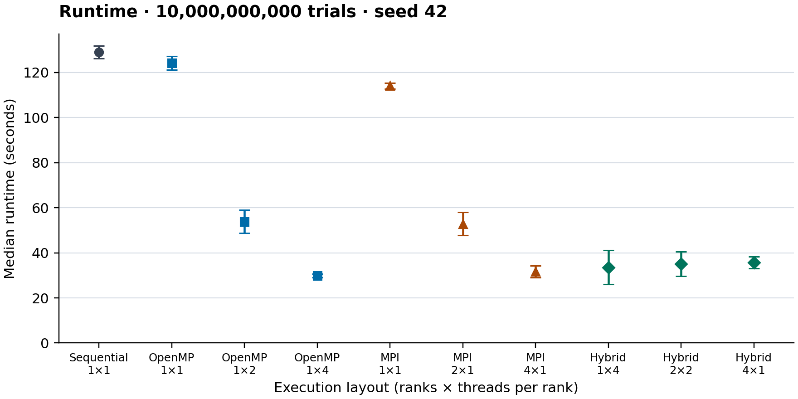
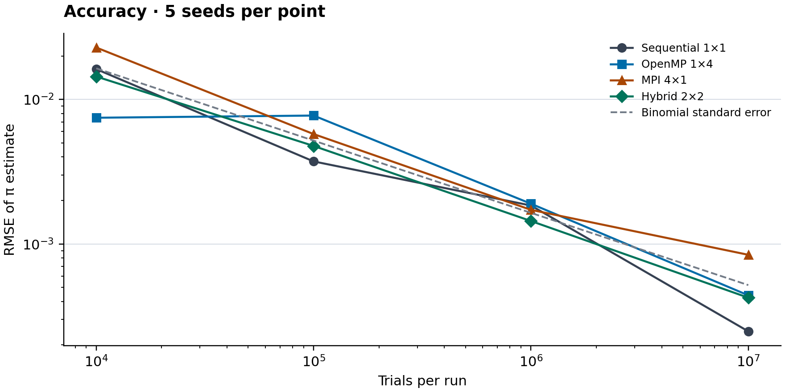

# Parallel Monte Carlo π estimation

Estimate π by sampling points in a unit square. This project compares the same
workload across sequential C, OpenMP, MPI, and hybrid MPI + OpenMP.

[Final report](documents/Monte-Carlo-Report.pdf) · [Raw benchmark data](results/2026-11-23/) · [All figures](results/figures/)

## Quick start

Use Linux or Ubuntu on WSL with GNU Make, a C17 compiler with OpenMP support,
and an MPI installation that provides `mpicc` and `mpiexec`.

**1. Build**

```sh
make seq omp mpi hybrid
```

**2. Run**

Each example uses one million trials and seed 42. The parallel examples use
four workers each.

```sh
./build/seq 1000000 42
OMP_NUM_THREADS=4 OMP_DYNAMIC=FALSE ./build/omp 1000000 42
mpiexec -n 4 ./build/mpi 1000000 42
OMP_NUM_THREADS=2 OMP_DYNAMIC=FALSE mpiexec -n 2 ./build/hybrid 1000000 42
```

**3. Read the result**

Each run emits a CSV header and one row with the worker layout, hits, estimate,
and elapsed seconds. Pass a positive trial count and an unsigned seed. Repeat
the same seed, trial count, and layout to reproduce the hit count.

## Measured results

The recorded experiment covered ten layouts on one four-core WSL2 host, with
two 10-billion-trial runs per layout.



Whiskers show the minimum and maximum of the two measured runtimes.



Each accuracy point combines five seeds. See the [experiment notes](results/README.md)
for placement, timing variability, and interpretation.

## Reproduce the experiment

The benchmark requires Python 3.9+, Linux CPU affinity, and `taskset`. Build
all four targets first and use a new output directory for each run.

```sh
python3 scripts/benchmark.py --output results/my-run --trials 10007 \
  --pilot-trials 1000 --repetitions 1 --accuracy-trials 1000 --seeds 0
python3 scripts/summarize.py results/my-run
python3 -m unittest discover -s tests -v
```

For the full benchmark, run `python3 scripts/benchmark.py --output results/full-run`.
The runner selects layouts that fit the host. Its hybrid benchmark layouts
require four physical cores. If launcher binding conflicts with worker
affinity, use `--mpi-args='-bind-to none'` with MPICH.

To rebuild the checked-in figures and report from the recorded summaries:

```sh
python3 -m pip install 'matplotlib>=3.6' reportlab
python3 scripts/plot_results.py results/2026-11-23 results/figures
python3 documents/build_report.py
```

## Project documents

[Proposal](documents/PDC%20Project%20Proposal%20%E2%80%93%20Parallel%20Monte%20Carlo%20Pi%20Estimation%20%281%29.docx) · [Requirements](documents/REQUIREMENTS.md) · [Feasibility](documents/FEASIBILITY.md) · [Architecture](documents/ARCHITECTURE.md) · [Implementation plan](documents/IMPLEMENTATION_PLAN.md)
